# Asadero Duke's — Sistema de gestión de pedidos (prototipo frontend)

> **Equipo 5:** Ramírez Fuentes Valeria Del Carmen - Hernández García Adán Aristeo - González Flores Ricardo - Ferraez Peréz Angela Yesmin_
> **Asignatura:** Aplicaciones Web · Unidad 2 Frontend · Actividad Sumativa 2 (LITIID41)

Prototipo frontend navegable y responsivo, con datos ficticios y estado local. **No** usa backend, API ni base de datos; los datos de demostración se guardan solo en el `localStorage` del navegador.

## Problema
En un asadero con venta de pedidos para llevar, la comunicación entre quien toma el pedido, la cocina y la caja suele hacerse de forma verbal o en notas de papel. Esto puede provocar pedidos que se pierden o se preparan en desorden, dudas sobre el estado de cada pedido, errores al calcular el total o el cambio, y un corte de caja difícil de cuadrar al final del día.

Asadero Duke's propone un sistema web donde cada rol trabaja en su propia interfaz con la información que necesita:
- **Mesero:** registra el pedido con sus productos y observaciones, lo envía a cocina y lo cobra.
- **Cocina:** ve los pedidos pendientes y actualiza su estado (Pendiente, En preparación, Listo y Entregado).
- **Administrador:** consulta los pedidos, administra productos, categorías y usuarios, y revisa el corte de caja y los reportes.

El objetivo de esta etapa es un prototipo frontend navegable y responsivo que demuestre ese flujo con datos ficticios y estado local, sin backend, para validar las pantallas antes de conectar una API y una base de datos.

## Flujo seleccionado
Pedido para llevar: el mesero registra el pedido → cocina lo prepara (Pendiente → En preparación → Listo) → el mesero lo cobra (Pagado) → el administrador lo consulta y hace el corte de caja.


**Reglas de negocio que cambian la interfaz**
- No se puede iniciar sesión con usuario o contraseña vacíos.
- No se puede enviar un pedido sin productos.
- Cocina avanza el estado en orden: Pendiente → En preparación → Listo → Entregado.
- Un pedido Pagado o Entregado ya no aparece en la lista de cobro.
- En efectivo, el monto recibido debe cubrir el total.

## Flujo del proceso

**Proceso:** Atención de pedidos para llevar en Asadero Duke's.

### Identificación del proceso

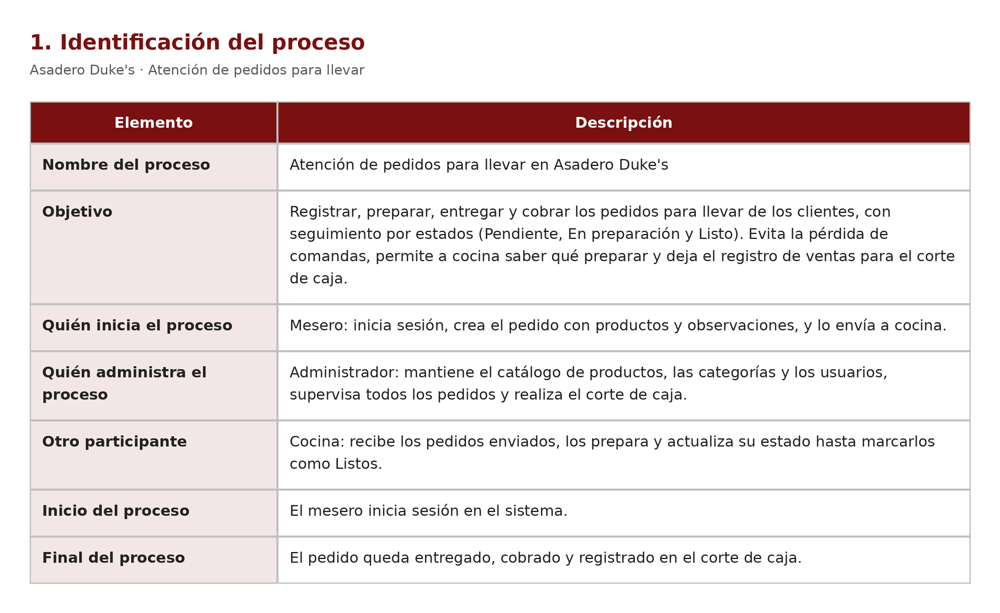

### Roles

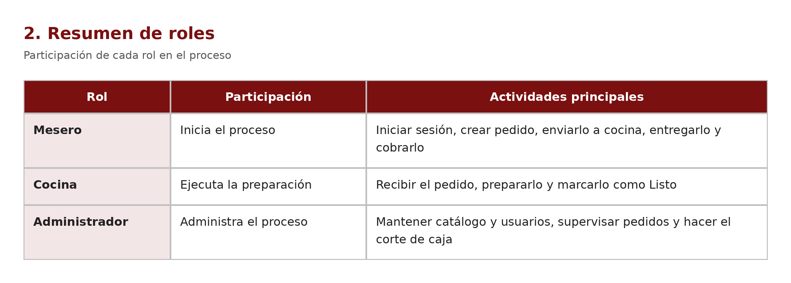

### Estados del pedido

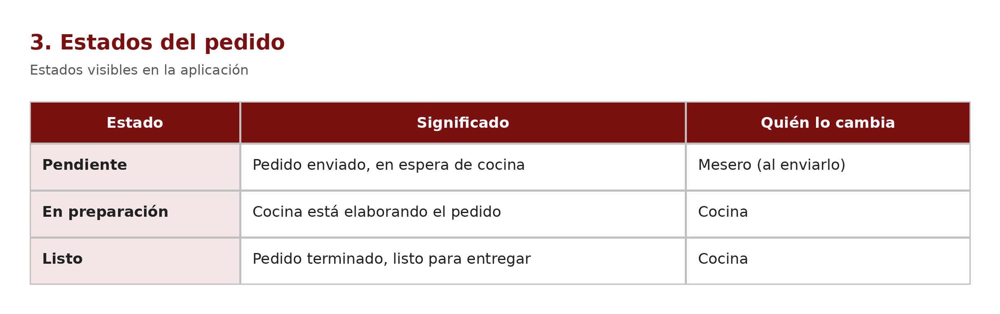

## Interfaces
| Interfaz | Ruta | Usuario | Se conecta con |
|---|---|---|---|
| Acceso (selección de rol) | `/` | Todos | Inicio de sesión |
| Inicio de sesión | `/login/:role` | Todos | Dashboard del rol |
| Dashboard admin | `/admin` | Administrador | Pedidos, productos, categorías, usuarios, corte, reportes |
| Pedidos / Productos / Categorías / Usuarios / Corte de caja / Reportes | `/admin/...` | Administrador | Menú lateral |
| Dashboard mesero | `/mesero` | Mesero | Nuevo pedido, mis pedidos, cobrar |
| Nuevo pedido / Mis pedidos / Cobrar pedido | `/mesero/...` | Mesero | Menú lateral |
| Dashboard cocina | `/cocina` | Cocina | Pedidos |
| Pedidos de cocina | `/cocina/pedidos` | Cocina | Menú lateral |
| Configuración (placeholder) | `/{rol}/configuracion` | Todos | Menú lateral |

## Mapa de navegación


Versión editable:

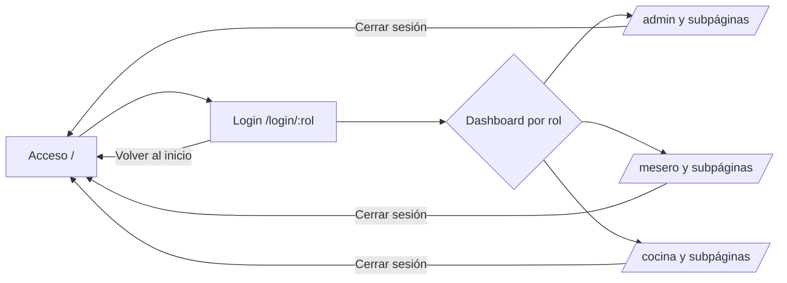

## Capturas
### Bocetos de baja fidelidad


### Capturas del prototipo
| Pantalla | 375 px | 768 px | 1280 px |
|---|---|---|---|
| Login | 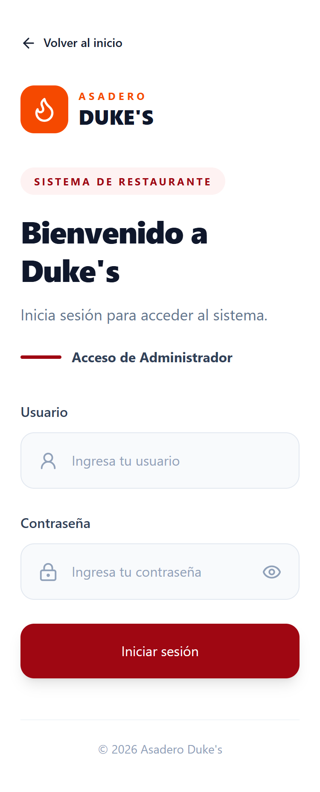 | 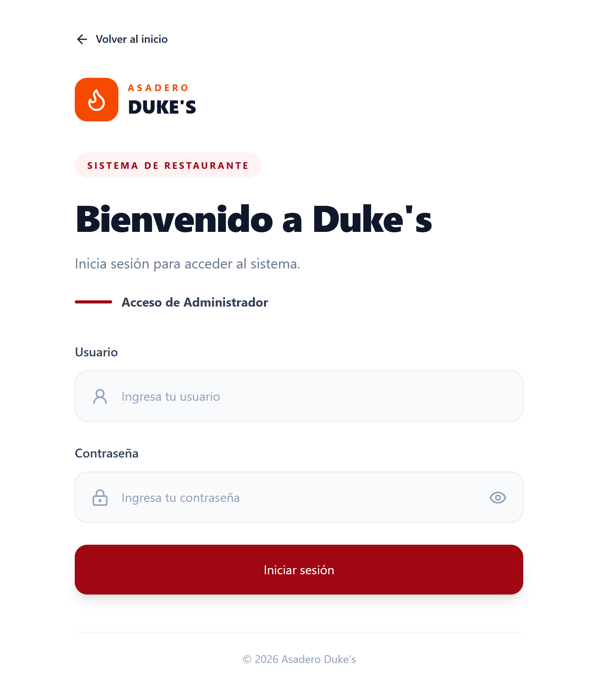 | 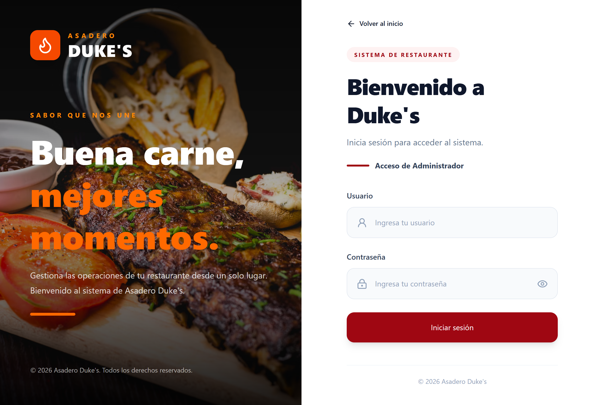 |
| Dashboard admin | 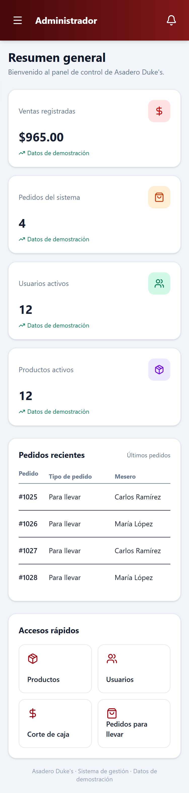 | 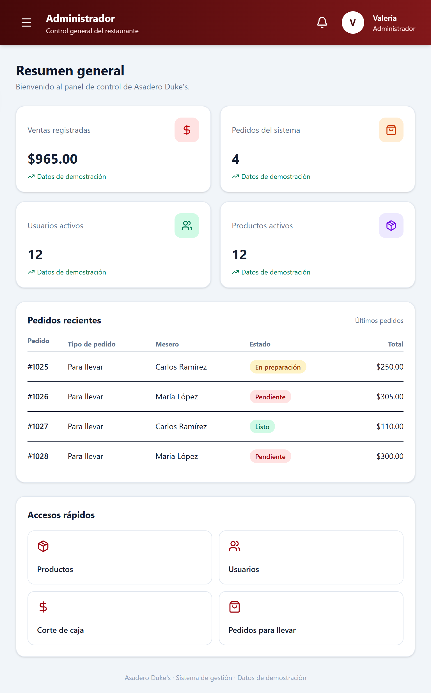 | 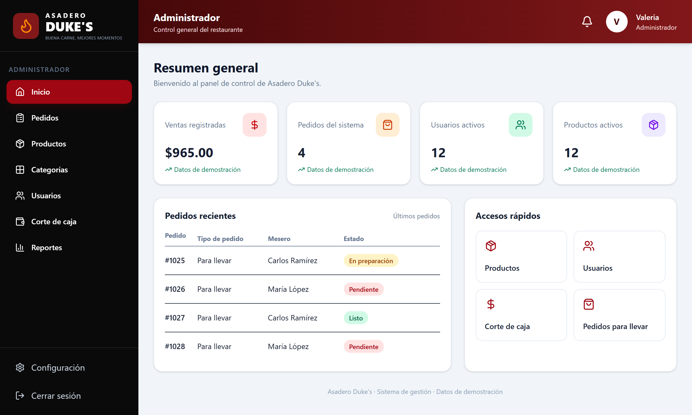 |
| Nuevo pedido | 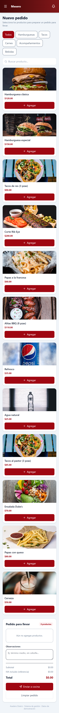 | 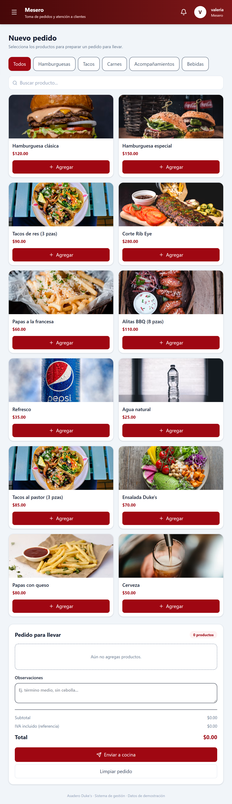 | 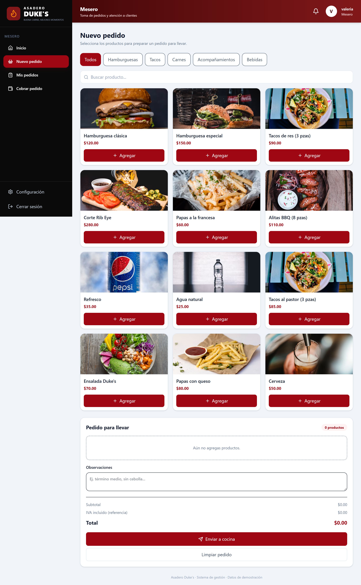 |
| Pedidos de cocina | 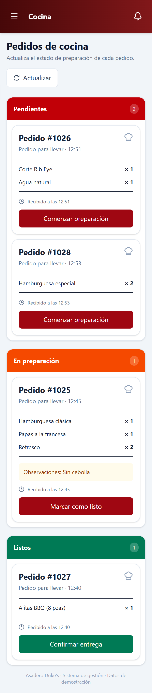 | 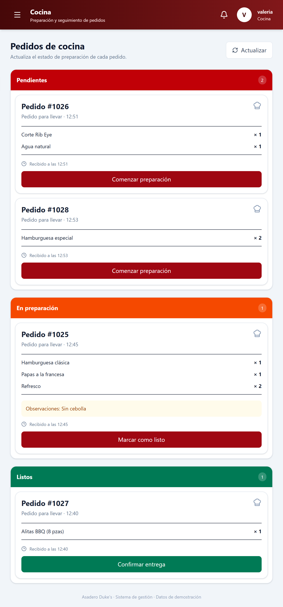 | 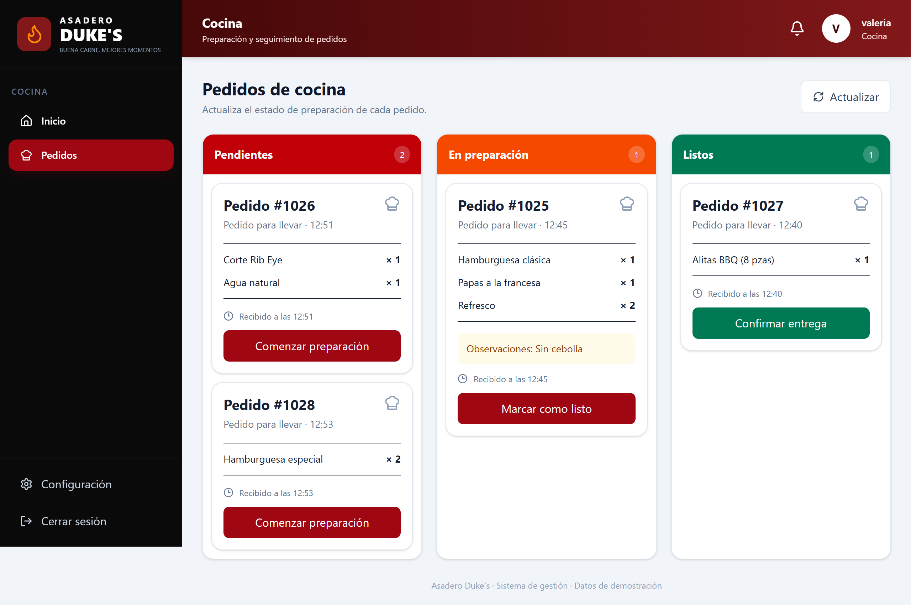 |
| Cobrar pedido | 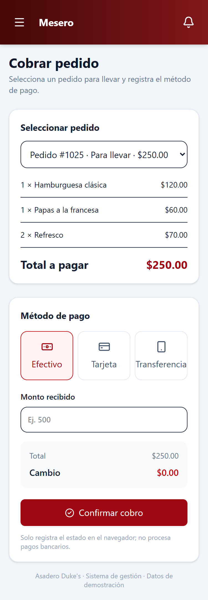 | 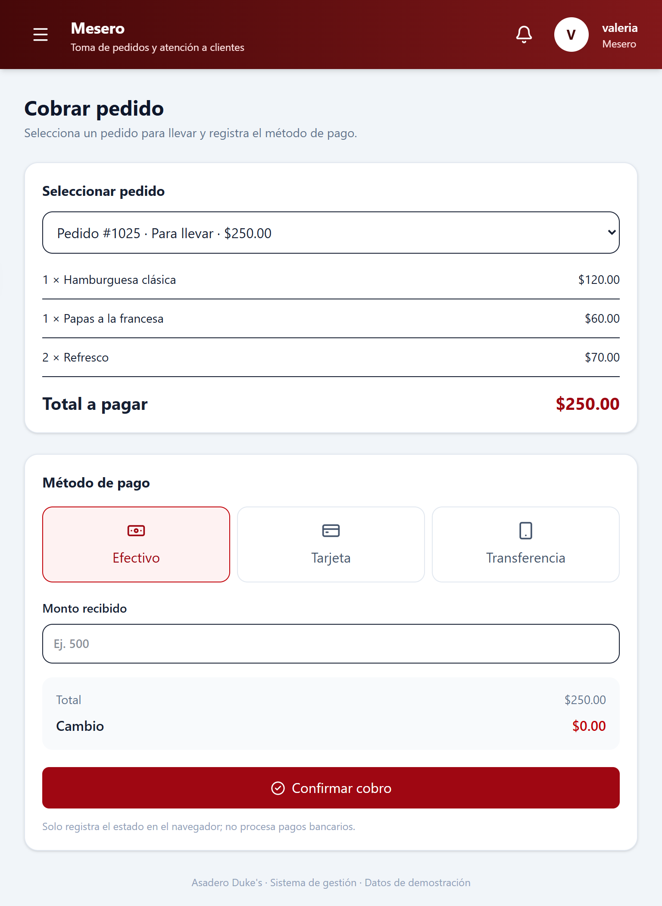 | 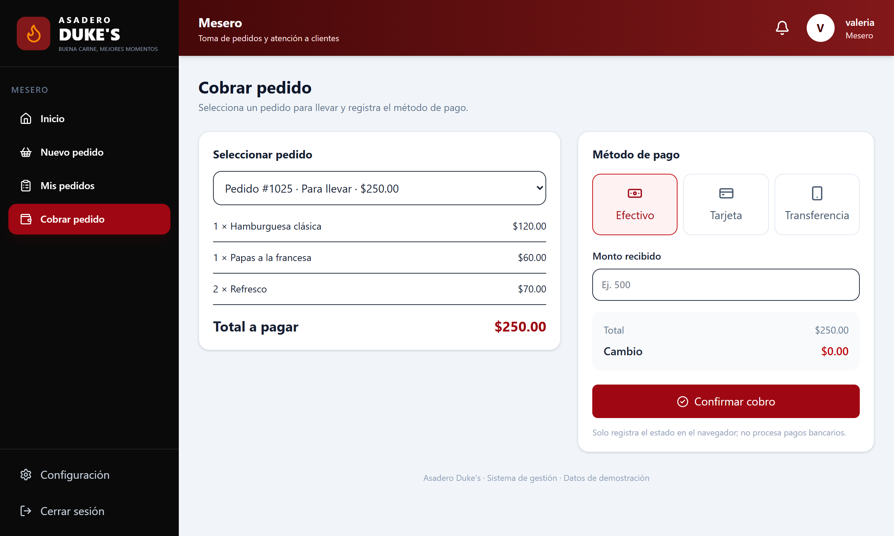 |

## Tecnologías
React 19, TypeScript, Vite, Tailwind CSS 4, React Router, lucide-react.

## Estructura
```
docs/         flujo-proceso.png, mapa-navegacion.png, mockups/
src/
├── components/   layout/AppShell.tsx, ui/Primitives.tsx
├── context/      AuthContext.tsx (sesión simulada)
├── data/         demo.ts (datos ficticios)
├── pages/        admin/, auth/, mesero/, cocina/
├── App.tsx       rutas
└── index.css     Tailwind y estilos globales
```

## Instalación y ejecución
```bash
git clone <https://github.com/angieyesmin/Asadero_Duke-s.git>
cd Asadero_Duke-s-main
npm install
npm run dev
```
Para compilar: `npm run build`. Acceso de demostración: cualquier usuario y contraseña no vacíos.
